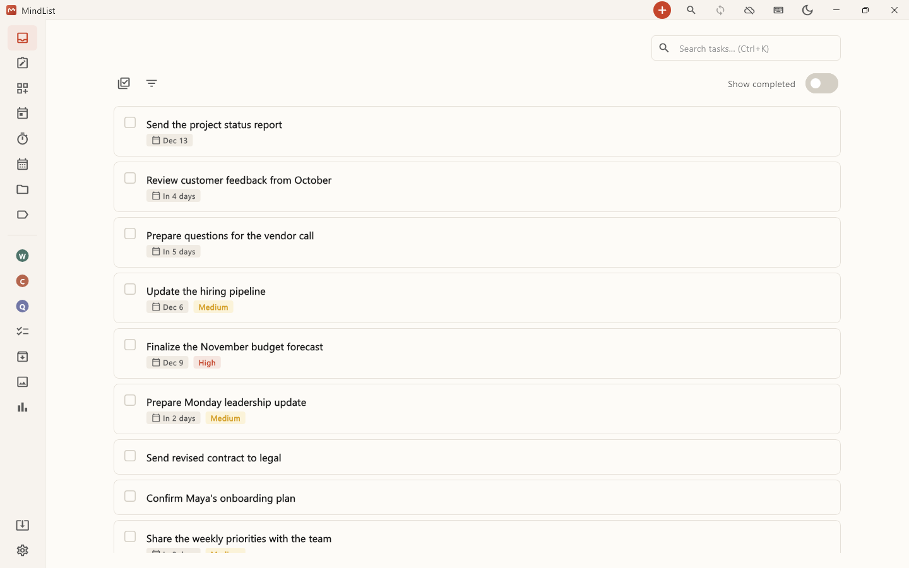
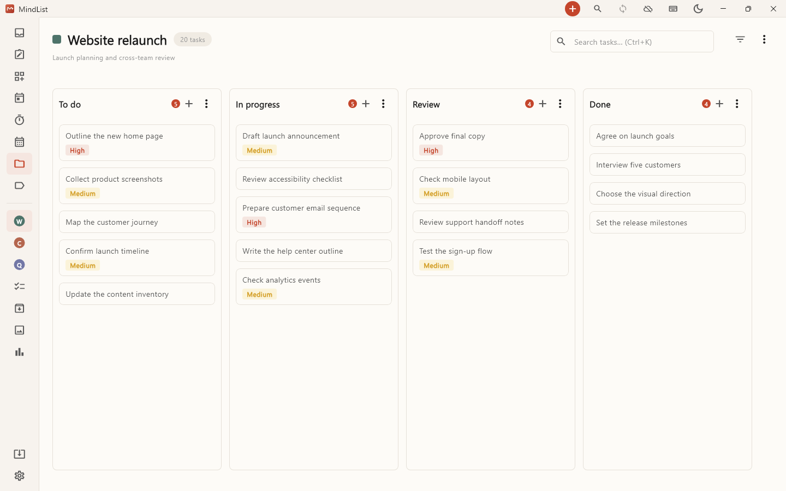
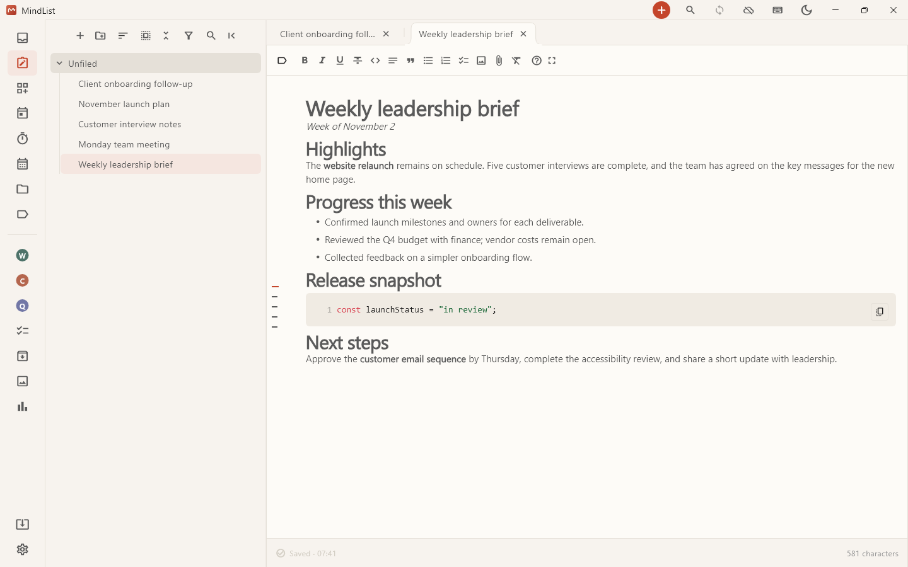
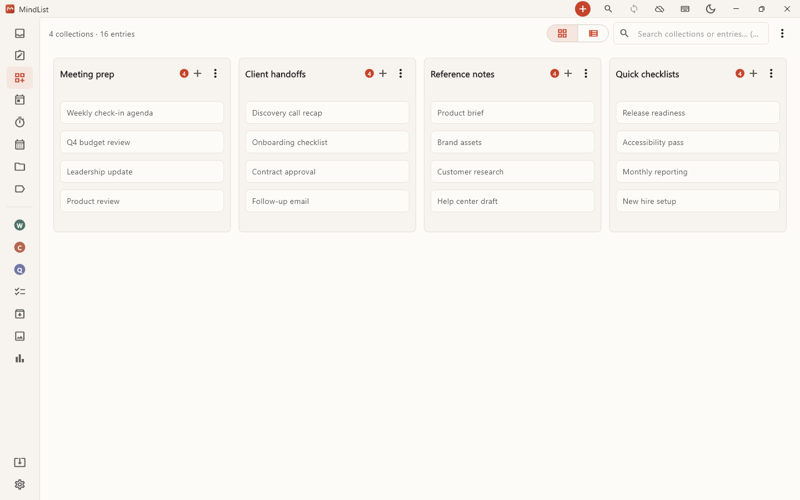
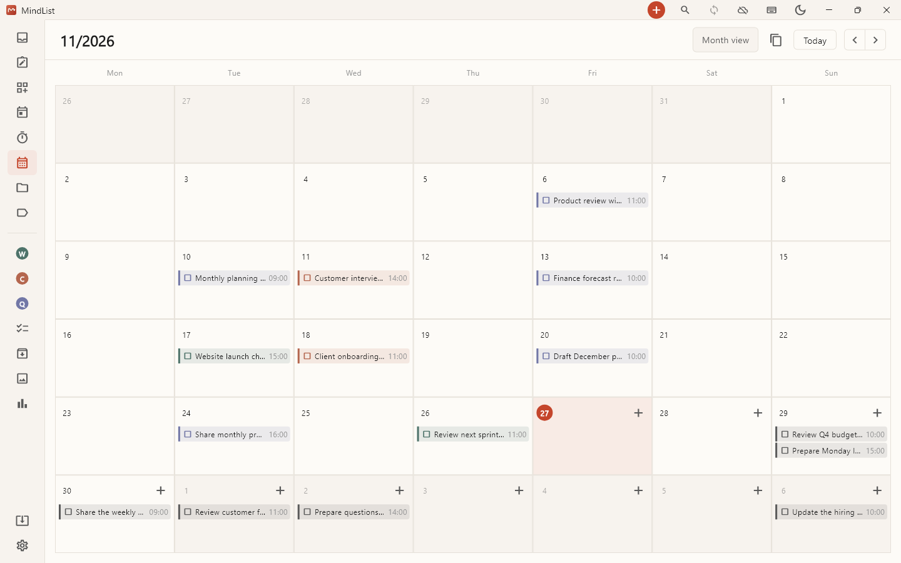
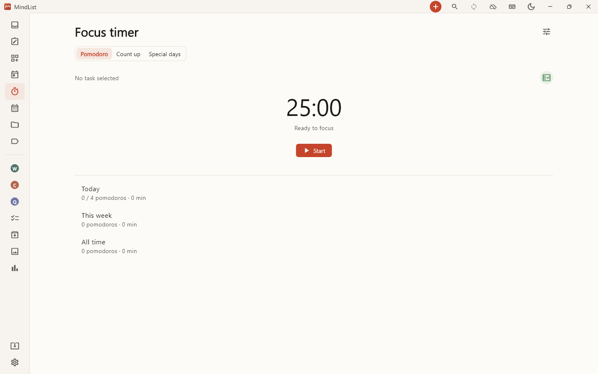

# MindList

**English** | [简体中文](README.zh-CN.md)

Most MindList features are free: tasks, projects, notes, collections, the calendar, and the focus timer. Use them locally without an account. Your work stays on your device, and MindList works offline. Free sync with your own storage does not require an account. A MindList account is needed for the one-time purchase that removes the custom sync device limit, or for a monthly official storage subscription.

## What you can do

Screenshots show the current Windows interface with English sample content. The website provides screenshots for all nine interface languages, including the focus timer.

### Inbox and tasks

Capture tasks as they come up, set priorities and due dates, and see today's and overdue work together. Repeat a task daily, weekly, monthly, or yearly; completing it creates the next future occurrence. Search your tasks or filter them by project, tag, priority, and date.

On desktop, double tap Shift to search across tasks, projects, collections, entries, and notes. Use the arrow keys to choose a result and Enter to open it. Page searches still filter the current list.

On Windows and Linux, the + button for new tasks is a filled circle in the theme color, just before Search in the window title bar. It remains available when the sidebar is hidden. On macOS, it stays at the top of the sidebar. You can also use the new-task shortcut (Ctrl+N by default) or the New task button in an empty inbox. The desktop inbox keeps search, filters, and bulk actions above the list, without a separate quick-create bar. Android and iOS keep their existing creation controls.

### Projects

Break a larger goal into steps and track them on a board. New projects start with To Do, In Progress, and Done columns; you can change the columns and move tasks between them. Archive projects and tasks when you no longer need them in your active workspace.

### Notes

Keep briefs, decisions, and the details behind your tasks. Organize notes in folders, use headings, lists, tables, images, and attachments, and export them as PDF, Word, Markdown, or HTML.

### Collections

Keep meeting agendas, handoff notes, reference material, and checklists together in collections.

### Calendar

Put deadlines and next steps on the calendar and see your plans by month. You can also copy a summary of what you completed this week.

Tasks with due times can remind you about an hour beforehand. On mobile, reminders can arrive while the app is closed; on Windows and Linux, MindList must be running. On Android, iOS, and macOS, Settings shows whether notifications and the microphone are turned on. Voice input is recognized on your device and inserts text directly into what you are editing.

The interface supports Simplified Chinese, Traditional Chinese, English, Japanese, Korean, German, French, Spanish, and Portuguese. Light, dark, and several additional appearance themes are available.

The [help center](https://mindlist.devinghub.com/help) has step-by-step desktop guides with screenshots generated from the current app in each interface language. Each chapter links back to the guide and has a topic menu. Select a screenshot to view it at full size. Open Help in the app to see the guide in your selected language.

### Focus timer

Start a 25-minute pomodoro or count up from zero. Link a task if you want to track what you worked on, then review your focus time and completed pomodoros. You can change the focus and break lengths, and save special dates with reminders.

## Where your data lives

Tasks, notes, attachments, and collections are stored on your current device. Without sync enabled, they stay there. For sync across devices, choose one of these options:

- **Official cloud storage.** Sign up with an email address and choose 1 GB for $5/month or 10 GB for $10/month; the checkout page shows the final price. Subscribe through the in-app payment page on desktop or the respective app store on mobile when available. Where Dodo billing is enabled, subscribers can switch between 1 GB and 10 GB on the account page. The updated account page shows the subscription status, why a change is blocked, and what to do next. Check again requests a fresh plan preview. Subscriptions scheduled to end can change plans while paid time remains and will keep automatic renewal off. An active subscription removes the device limit for both official and custom sync. Automatic sync checks for changes when the app opens and at the interval you set.
- **Your own cloud storage.** Connect AWS S3, Cloudflare R2, Alibaba Cloud OSS, Tencent Cloud COS, or another S3-compatible service. Enter the connection details and test them before saving. MindList does not charge for custom sync, though your storage provider may. Without a one-time purchase or active official subscription, each sync space supports two devices. A $10 one-time purchase linked to your MindList account removes that limit; it does not include official storage. On desktop, accounts with an active subscription or a one-time purchase show My plan, which opens the account dashboard without another sign-in. Accounts without either show View purchase options, which opens the web plan page. The card highlights your current plan and groups the plan and subscription controls, with an explanation of where to manage payments and renewals. The app writes files directly to your provider.

Choosing a paid plan on the website keeps that selection through registration, email verification, and login. The account page shows the selected plan and a separate checkout button; signing in does not start a payment.

Account overview in the web dashboard shows your plan, expiry date, payment channel, and official storage use, with a link to manage your plan. An empty space includes expandable app setup instructions. Local data and custom storage are not counted here. Password changes and account deletion are under Account and security; terms and privacy have their own tab.

Official storage offers six R2 locations. MindList tests them from your device, recommends the fastest result, and lets you choose another. Existing encrypted files are copied before the switch; if the move fails, the original location remains in use.

If an app update changes the sync data format, an older cloud space may need force alignment before normal sync resumes. In sync settings, choose **Force-align sync**, then select the data to keep: this device or the remote space. MindList creates an encrypted local backup first; data found only on the other side will be replaced.

On Windows, macOS, and Linux, you can choose the local data folder. On mobile, the operating system provides the app's storage location.

## Data and security

- **Backups and synced files are encrypted.** Set an encryption password to protect local backups, exported backups, and files uploaded to official or personal cloud storage. The password is kept in the current device's secure storage. MindList cannot see or reset it.
- **Your account password is separate.** An account password can be reset by email. If you lose the encryption password, you cannot restore the backups and cloud copies it protected. After changing it, new backups and sync use the new password; older backups still need the old one.
- **Restoring a backup requires its password.** MindList explains what will be affected and backs up your current data before replacing it.
- **Official storage holds encrypted content.** MindList can see your email, plan, storage use, and connected devices, but cannot read your tasks, notes, or attachments. If the space fills up, you can still view existing content; uploads resume after you free space or upgrade. Deleting an account removes its registered encrypted files from official storage but does not delete local data or files in storage you own. Manage Google Play and App Store subscriptions through those stores.
- **Your storage provider receives encrypted files.** Storage credentials stay in the device's secure storage and are not included in backups. Clearing sync settings disconnects that device without deleting cloud files.
- **Sync connections use encryption by default.** An unencrypted address is allowed only on a local network after explicit confirmation. If two devices edit the same item at once, the version that syncs first is kept; the other unsynced change can be overwritten. The sync log records the conflict.
- **Working data on the device is not fully encrypted.** Set an operating-system screen lock and protect the local data folder. The separate "private" setting hides marked projects, notes, and folders from casual viewing, but project names and note titles remain visible. Its password is set per device, cannot be recovered, and does not protect copied data files. Closing the app locks private content again.
- **Voice recordings are temporary.** Audio used for recognition is not saved or uploaded. Runtime logs stay on your device and are not sent automatically.

## Download

The [website download section](https://mindlist.devinghub.com/#download) offers packages by platform, architecture, and format. All published packages are also on [GitHub Releases](https://github.com/huagelong/mindlist-releases/releases).

| Platform | Packages |
| --- | --- |
| Windows | x64 or ARM64; installer or portable ZIP |
| macOS | Apple silicon (ARM64) or Intel (x64) ZIP |
| Linux | AppImage and compatibility AppImage for x86_64; DEB for amd64/arm64; RPM for x86_64/aarch64 |
| Android | APK for arm64-v8a, armeabi-v7a, or x86_64; arm64-v8a suits most phones |
| iPhone / iPad | App Store coming soon |

Google Play is also coming soon. The website reads the latest published release; if it cannot load the package list, use the release-page link.

Use the official website or release page to download MindList. The app can check for updates and verifies an installer before updating.

## Publishing

Maintainers run **Build and publish MindList** from this repository's Actions tab with a `vX.Y.Z` tag already pushed to the private `huagelong/mindlist` repository. The workflow checks that the tag belongs to its `main` branch, builds every supported platform, uploads the final packages to a draft Release, and publishes the Release and update metadata after all packages are present.

Google Play internal test bundles are built in the private `huagelong/mindlist` repository. This public repository does not run Play test builds or retain their build logs. The signed AAB remains available to maintainers as an artifact of the private workflow for seven days and is uploaded only to Play Console's internal testing track.

Repository secrets `MINDLIST_SOURCE_TOKEN` (read-only access to the private source repository), `ANDROID_KEYSTORE_BASE64`, `ANDROID_KEYSTORE_PASSWORD`, and `ANDROID_KEY_PASSWORD` are required. Repository variable `ANDROID_KEY_ALIAS` is also required. Sentry secrets and variables are optional. The workflow uses this repository's `GITHUB_TOKEN` to write the Release and update metadata. Build caches and intermediate build artifacts are not retained; the Pages workflow uses a site artifact. Temporary build files are removed with the hosted runners. Published Release packages remain available for download.

The Windows installer installs for the current user and normally needs no administrator permission. An "Unknown publisher" warning may appear because the installer does not yet have a commercial code-signing certificate. On Android, download the APK and follow the system's installation prompts.
