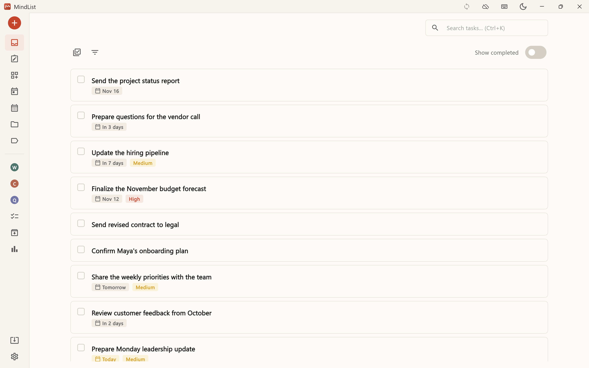
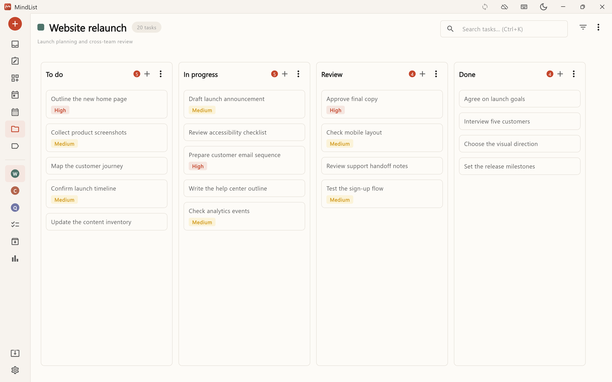
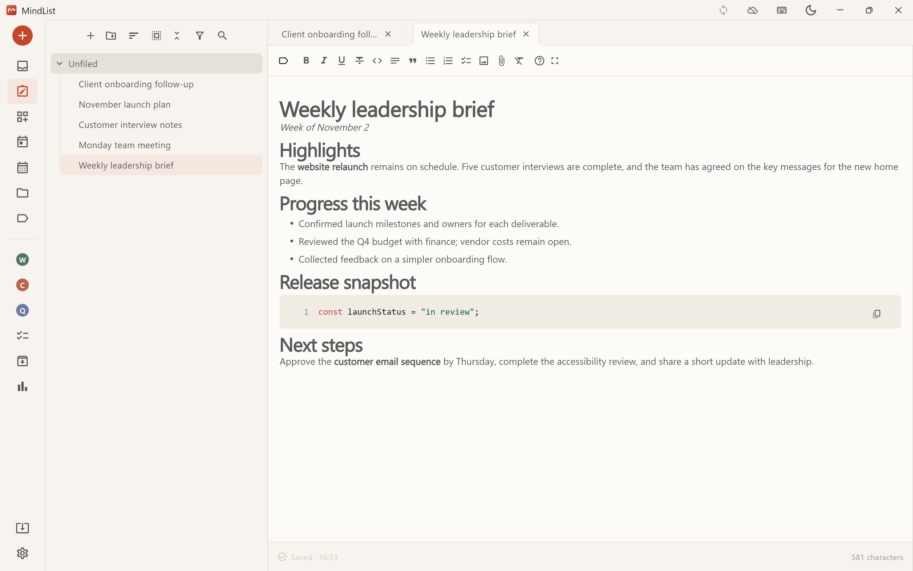
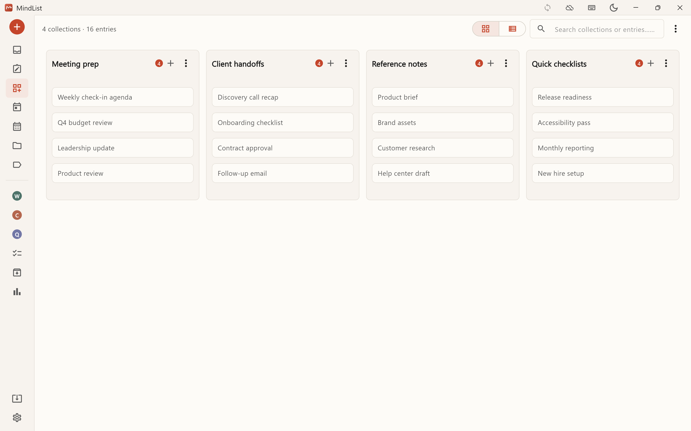
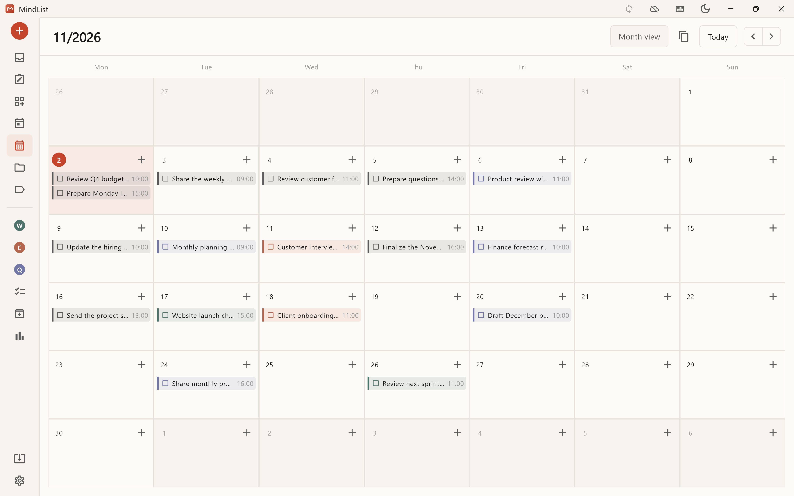

# MindList

**English** | [简体中文](README.zh-CN.md)

MindList brings tasks, projects, notes, collections, and your calendar into one personal workspace. Your work stays on your device, and the app works offline. You do not need an account for local use or to sync with your own cloud storage. An account and subscription are needed only for MindList's official cloud storage.

## What you can do

### Inbox and tasks

Capture tasks as they come up, set priorities and due dates, and see today's and overdue work together. Search all tasks or filter them by project, tag, priority, and date.

### Projects

Break a larger goal into steps and track them on a board. New projects start with To Do, In Progress, and Done columns; you can change the columns and move tasks between them. Archive projects and tasks when you no longer need them in your active workspace.

### Notes

Keep briefs, decisions, and the details behind your tasks. Organize notes in folders, use headings, lists, tables, images, and attachments, and export them as PDF, Word, Markdown, or HTML.

### Collections

Group the details you reach for often, such as meeting agendas, client handoffs, reference material, and checklists.

### Calendar

Put deadlines and next steps on the calendar and see your plans by month. You can also copy a summary of what you completed this week.

Tasks with due times can remind you about an hour beforehand. On mobile, reminders can arrive while the app is closed; on Windows and Linux, MindList must be running. Voice input is recognized on your device and inserts text directly into what you are editing.

The interface supports Simplified Chinese, Traditional Chinese, English, Japanese, Korean, German, French, Spanish, and Portuguese. Light, dark, and several additional appearance themes are available.

## Where your data lives

Tasks, notes, attachments, and collections are stored on your current device. Without sync enabled, they stay there. For sync across devices, choose one of these options:

- **Official cloud storage.** Sign up with an email address and subscribe to 1 GB for $5/month or 10 GB for $10/month; the checkout page shows the final price. Subscribe through the in-app payment page on desktop or the respective app store on mobile when available. Official storage works across your devices without the two-device limit. With automatic sync enabled, updates from other devices arrive as soon as possible; the app also retries when opened or at the configured interval after background or network interruptions.
- **Your own cloud storage.** No account is needed. Connect AWS S3, Cloudflare R2, Alibaba Cloud OSS, or Tencent Cloud COS. MindList does not charge for this option, and each sync space supports up to two devices. The app writes files directly to your storage provider.

On Windows, macOS, and Linux, you can choose the local data folder. On mobile, the operating system provides the app's storage location.

## Data and security

- **Backups and synced files are encrypted.** Set an encryption password to protect local backups, exported backups, and files uploaded to official or personal cloud storage. The password is kept in the current device's secure storage. MindList cannot see or reset it.
- **Your account password is separate.** An account password can be reset by email. If you lose the encryption password, you cannot restore the backups and cloud copies it protected. After changing it, new backups and sync use the new password; older backups still need the old one.
- **Imports preserve a recovery path.** Restoring a backup requires the password used to create it. MindList explains what will be affected and keeps the current data before replacing it.
- **Official storage holds encrypted content.** MindList can see your email, plan, storage use, and connected devices, but cannot read your tasks, notes, or attachments. If the space fills up, you can still view existing content; uploads resume after you free space or upgrade. Deleting an account removes its registered encrypted files from official storage but does not delete local data or files in storage you own. Manage Google Play and App Store subscriptions through those stores.
- **Personal storage also receives encrypted content.** Your provider sees encrypted files. Storage credentials stay in the device's secure storage and are not included in backups. Clearing sync settings disconnects that device without deleting cloud files.
- **Sync connections use encryption by default.** An unencrypted address is allowed only on a local network after explicit confirmation. If two devices edit the same item at once, the version that syncs first is kept; the other unsynced change can be overwritten. The sync log records the conflict.
- **Working data on the device is not fully encrypted.** Set an operating-system screen lock and protect the local data folder. The separate "private" setting hides marked projects, notes, and folders from casual viewing, but project names and note titles remain visible. Its password is set per device, cannot be recovered, and does not protect copied data files. Closing the app locks private content again.
- **Voice recordings are temporary.** Audio used for recognition is not saved or uploaded. Runtime logs stay on your device and are not sent automatically.

## Download

Installers for Windows, Linux, and Android are available on the [GitHub Releases page](https://github.com/huagelong/mindlist-releases/releases). Google Play and the App Store are coming soon.

Download only from that page. MindList can check for updates in the app and verifies an installer before updating.

## Publishing

Maintainers run **Build and publish MindList** from this repository's Actions tab with a `vX.Y.Z` tag already pushed to the private `huagelong/mindlist` repository. The workflow checks that the tag belongs to its `main` branch, builds every supported platform, uploads the final packages to a draft Release, and publishes the Release and update metadata after all packages are present.

For Google Play internal testing, run **Build Google Play internal test bundle** with a tag on the private `main` branch. It uses the existing Android signing key and points the bundle to the staging server. Leave both product ID inputs empty for the first upload that unlocks subscription setup; after creating the products, provide both IDs for a purchase test build. Download the signed AAB from the run's artifact within seven days and upload it only to Play Console's internal testing track. This workflow does not publish a GitHub Release or submit a Play production release.

Repository secrets `MINDLIST_SOURCE_TOKEN` (read-only access to the private source repository), `ANDROID_KEYSTORE_BASE64`, `ANDROID_KEYSTORE_PASSWORD`, and `ANDROID_KEY_PASSWORD` are required. Repository variable `ANDROID_KEY_ALIAS` is also required. Sentry secrets and variables are optional. The workflow uses this repository's `GITHUB_TOKEN` to write the Release and update metadata. Build caches and intermediate build artifacts are not retained; the Pages workflow uses a site artifact. Temporary build files are removed with the hosted runners. Published Release packages remain available for download.

The Windows installer installs for the current user and normally needs no administrator permission. An "Unknown publisher" warning may appear because the installer does not yet have a commercial code-signing certificate. On Android, download the APK and follow the system's installation prompts.
