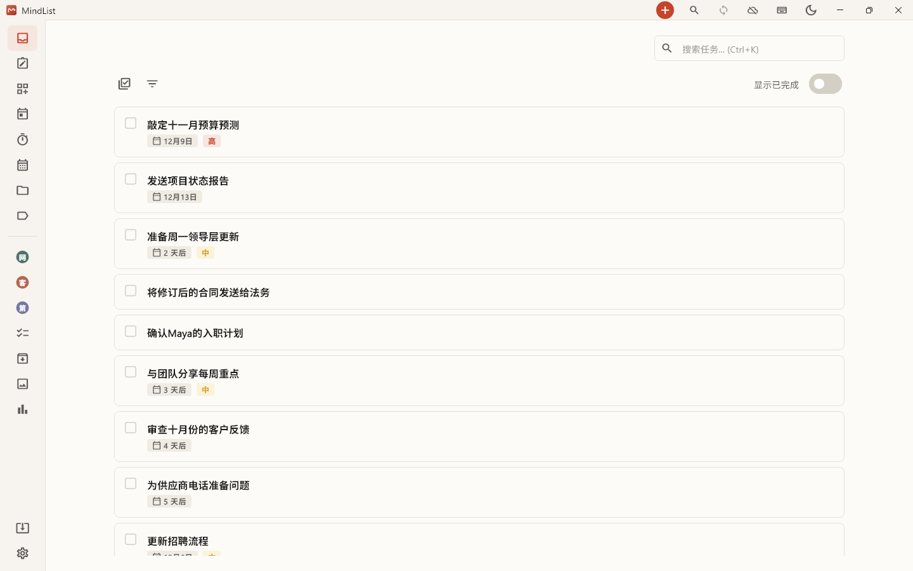
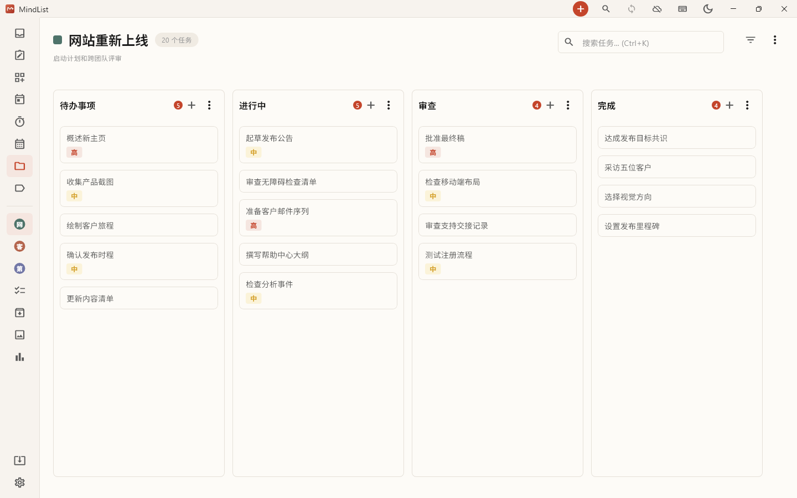
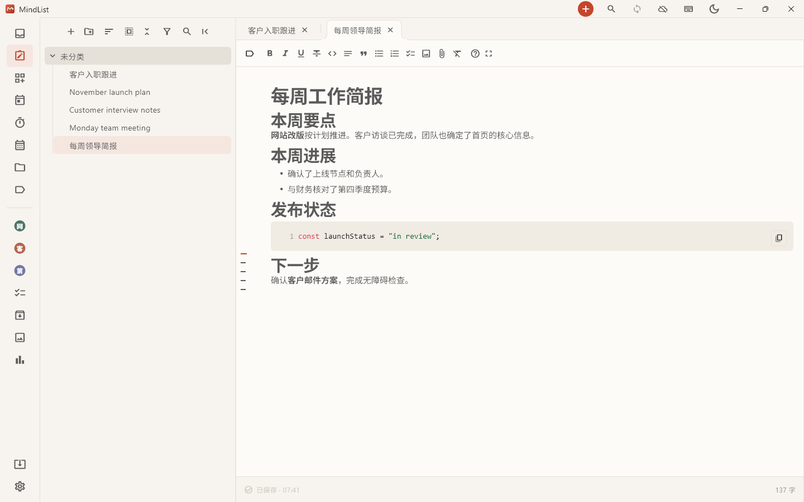
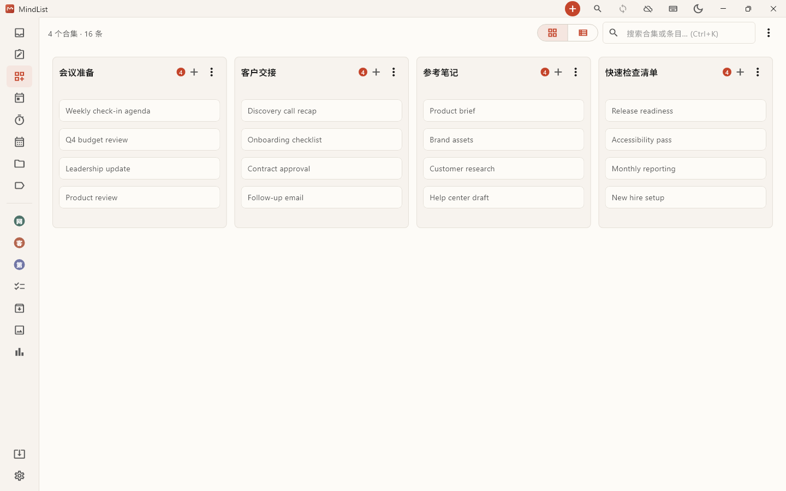
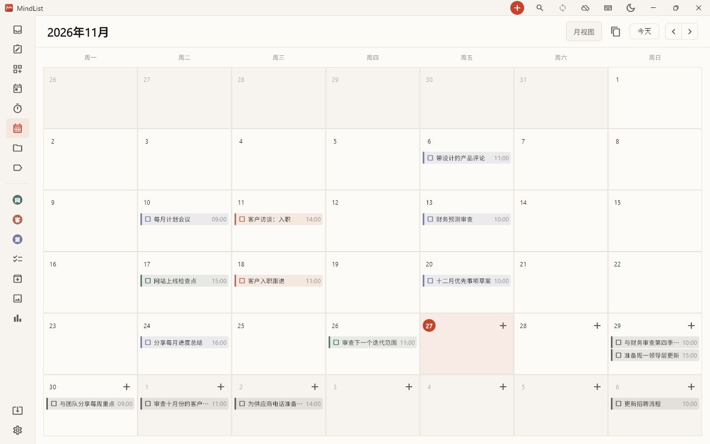
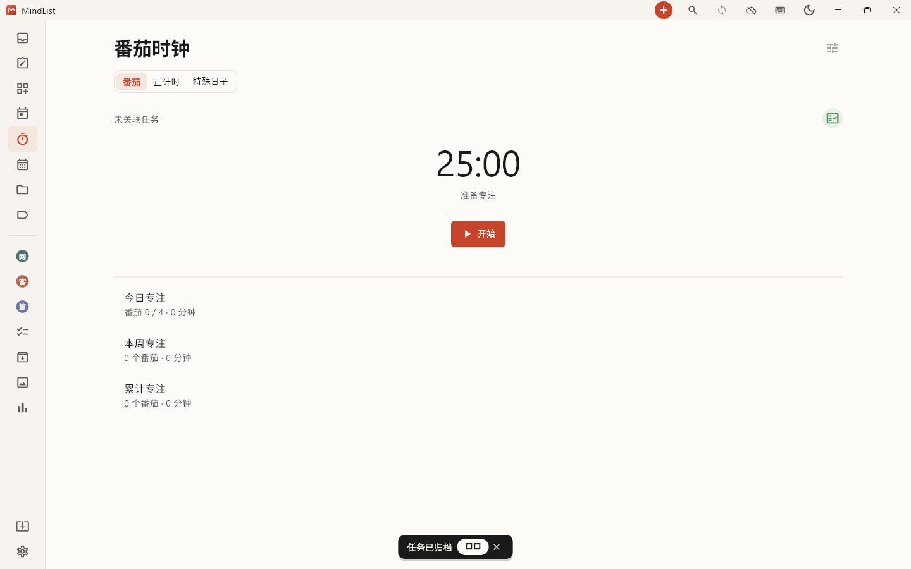

# MindList

[English](README.md) | **简体中文**

MindList 的任务、项目、笔记、合集、日历和番茄时钟在本机可免费使用，无需账号。当前发布页提供 Windows、macOS、Linux 和 Android 安装包。

内容保存在你的设备上，断网也能使用。本机使用和免费连接自备存储都不需要账号；购买自定义同步的不限设备权益或订阅官方云空间时，需要注册 MindList 账号。

## 可以做什么

下方截图使用当前 Windows 界面和中文演示内容。官网提供九种界面语言的对应截图，包含番茄时钟。

### 任务

把零散待办收进收集箱，设置优先级和截止日期。定期任务可设为每天、每周、每月或每年重复，完成后生成下一期。今日页集中显示当天和逾期任务；全部任务支持搜索，并可按项目、标签、优先级和日期筛选。

桌面端双击 Shift 可搜索任务、项目、合集、条目和笔记；用方向键选择结果，按 Enter 打开。各页面的搜索框继续筛选当前列表。

Windows 和 Linux 的新建任务“＋”使用浅主题色底的圆角按钮，位于窗口标题栏的综合搜索图标左边，收起侧栏后仍可使用；macOS 保留侧栏顶部的“＋”。也可用新建任务快捷键（默认 Ctrl+N）或空列表中的“新建任务”添加任务。桌面收集箱顶部保留搜索、筛选和批量操作，不再显示整条快速新建栏。Android 和 iOS 保留原有的新建入口。

### 项目

把大目标拆成步骤，用看板追踪进展。新项目有“待开始、进行中、已完成”三列，也可以增删和调整列、拖动任务。项目和任务可以归档，之后恢复或删除。

### 笔记

记录简报、决策和任务背后的细节。笔记可以按文件夹归类，支持标题、列表、表格、图片和附件，并可导出为 PDF、Word、Markdown 或网页文件。

桌面端笔记、任务和合集编辑器默认限制正文行宽；需要更宽的编辑区域时，可在设置中选择“内容全铺”。

### 合集

把会议提纲、交接信息、参考资料和清单放进合集，方便查找。

合集可切换瀑布流、按最近更新排序的跨合集列表，以及专注单个合集的工作台。工作台按原有顺序显示条目。宽屏下可在右侧直接编辑富文本、图片和附件；切换条目、合集或视图前会保存。较窄屏幕仍使用条目弹窗编辑器。

### 日历

把截止日期和下一步安排进日历，按月查看计划，也可以复制本周完成情况。

设置了截止时间的任务，会在截止前大约 1 小时提醒。手机上即使应用没有打开也能提醒；Windows 和 Linux 需要 MindList 正在运行。Android、iOS 和 macOS 可在设置中查看通知和麦克风是否已打开。语音输入在你的设备上识别，说出的内容直接进入正在编辑的文字。

界面支持简体中文、繁体中文、英语、日语、韩语、德语、法语、西班牙语和葡萄牙语，也可以在浅色、深色和暖陶、蓝图、澄蓝、墨白几种外观之间切换。

[使用帮助](https://mindlist.devinghub.com/zh/help)按操作步骤展示当前客户端的桌面截图，并提供九种界面语言。章节页顶部可返回手册首页或打开目录；点击截图可查看原尺寸。在应用内打开“帮助”，即可查看当前所选语言的手册。

### 番茄时钟

默认从 25 分钟专注开始，也可以用正计时记录专注时间。计时可关联任务，完成后查看专注时长和番茄数。专注与休息时长可以调整，还能保存特殊日子并设置提醒。

## 数据放在哪里

日常使用的任务、笔记、附件和合集都保存在当前设备上。不开启同步时，这些内容不会离开这台设备。

多台设备同步时，选择下面其中一种方式：

- **官方云空间。** 用邮箱注册 MindList 账号后，可选择 1 GB 每月 5 美元或 10 GB 每月 10 美元，实际金额以结账页面为准。电脑可在应用内付款；移动应用上架商店后，可通过相应商店订阅和管理订阅。开通 Dodo 支付的环境支持在账号页切换 1 GB 与 10 GB 套餐；订阅状态阻止切换时，新版账号页会显示具体状态、原因和处理建议，点击“重新检查”可再次查询。已关闭自动续费但仍在有效期内的订阅可以换档，换档后保持不自动续费。订阅有效期间，官方与自定义同步都不限设备。打开自动同步后，应用会在启动和到达设定周期时检查其他设备的更新。
- **自己的云存储。** 可以连接 AWS S3、Cloudflare R2、阿里云 OSS、腾讯云 COS 或其他 S3 兼容存储。填写连接信息并测试通过后保存。自定义同步无需向 MindList 付费，但存储服务商可能收费。没有买断权益或有效官方订阅时，每个同步空间最多连接两台设备；绑定 MindList 账号后一次性支付 10 美元，可解除自定义同步设备限制，但不包含官方云空间。电脑端账号有有效订阅或已买断时，显示“我的套餐”，点击打开网页版账号后台，无需再次登录；未购买时显示“前往购买”，点击进入套餐购买页。卡片突出当前套餐，集中展示套餐和订阅管理入口，并说明付款与续费的管理渠道。文件由应用直接写入你选择的存储服务商。

在官网选择付费方案后，注册、邮箱验证和登录都会保留该选择。账号页显示所选方案，再点击“继续前往结账”进入付款；登录本身不会发起付款。

网页版仪表盘的“账号概览”显示套餐、有效期、支付渠道和官方空间用量，可直接进入套餐管理。空间为空时可展开客户端设置说明；这里不统计本机或自备存储的数据。修改密码和删除账号位于“账号与安全”，条款与隐私保留独立入口。

官方云空间提供六个 R2 存储位置。MindList 会在当前设备测速并推荐最快的位置，也可以自行改选。切换时先复制已有的加密文件；迁移失败则继续使用原位置。

应用更新后如果同步数据格式发生变化，旧云空间可能需要先强制对齐才能继续普通同步。在同步设置中打开“强制对齐同步”，选择保留本机还是远端数据。操作前会创建本地加密备份，另一端独有的数据会被替换。

Windows、macOS 和 Linux 可以把本机保存位置改到自己选择的文件夹。手机使用系统为应用准备的位置。

## 数据安全

- **备份和同步文件会先加密。** 设置加密密码后，本地备份、导出的备份，以及上传到官方云空间或自己的云存储的文件，都会用这个密码加密。没有密码就打不开。密码保存在当前设备的系统安全区域。MindList 看不到这个密码，也不能帮你重置。
- **账号密码和加密密码不同。** 账号密码用于登录 MindList 账号，忘记后可以通过邮箱重置。加密密码丢失后，对应的备份和云端副本无法恢复。修改加密密码后，新的备份和之后的同步使用新密码；以前的备份仍要用旧密码打开，请把旧密码一并留好。
- **恢复备份需要原密码。** 导入前会说明受影响的内容，并备份当前数据，确认后才会覆盖。
- **官方云空间看不到正文。** MindList 只托管已经加密的文件，可以知道邮箱、订阅档位、已用空间和已连接的设备，但不能阅读任务、笔记和附件。空间用满后仍可查看已有内容，腾出空间或升级后才能继续上传。删除账号会清理官方云空间中已登记的加密文件，但不会删除本机或自有存储空间中的数据。Google Play 和 App Store 订阅须在相应商店管理。
- **自备存储收到的是加密文件。** 连接用的密钥只保存在设备的系统安全区域，不会写进备份。清除同步设置只会断开这台设备的连接，不会删除云端文件。
- **同步连接默认加密。** 只有你明确确认后，自己的云存储才可以使用仅限局域网的未加密地址。两台设备同时修改同一内容时，先成功同步到云端的版本会保留；另一台还没同步的修改会被覆盖，同步日志里可以查看。
- **正在使用的数据没有整库加密。** 为了离线打开和日常使用，设备上正在使用的数据文件没有再用加密密码封存。请为电脑和手机设置系统锁屏，不要把数据文件夹交给别人。
- **“私密”用来防止旁人瞥见。** 项目、笔记和文件夹可以标为私密。未解锁时正文会被挡住，但项目名称和笔记标题仍然可见。每台设备单独设置私密密码，保持解锁的时间可以自己选择，关闭应用后都会重新锁上。它不能防止别人复制设备上的数据文件，忘记后也没有找回途径。
- **语音不会被保存或上传。** 录音只在识别过程中临时使用，不会保存成音频文件。
- **运行日志保存在本机。** 应用不会自动上传运行日志或崩溃信息。

## 下载

[官网下载区](https://mindlist.devinghub.com/zh#download)按系统、芯片架构和安装方式列出安装包，也可在 [GitHub Releases](https://github.com/huagelong/mindlist-releases/releases) 查看全部文件。

| 系统 | 安装包 |
| --- | --- |
| Windows | x64、ARM64；安装版或便携 ZIP |
| macOS | Apple 芯片（ARM64）、Intel（x64）ZIP |
| Linux | x86_64 AppImage 及兼容版；amd64/arm64 DEB；x86_64/aarch64 RPM |
| Android | arm64-v8a、armeabi-v7a、x86_64 APK；多数手机使用 arm64-v8a |
| iPhone / iPad | App Store 即将上线 |

Google Play 也尚未上架。官网读取最新已发布版本，暂时无法加载安装包列表时，可通过发布页链接下载。

请只从上面的页面下载。安装之后，可以在应用里检查更新；更新前会先确认安装包完整。

Windows 安装程序按当前用户安装，通常不需要管理员权限。如果系统提示“未知发布者”，是因为安装包尚未购买商业代码签名证书。

Android 需要下载安装包后，按系统提示完成安装。

## 发布维护

维护者先将 `vX.Y.Z` 标签推送到私有的 `huagelong/mindlist` 仓库，再在本仓库 Actions 页手动运行 **Build and publish MindList**，输入该标签。工作流会验证标签属于私有仓库 `main` 分支，构建各平台安装包，全部上传并核对后发布 Release 和更新元数据。

Google Play 内部测试包在私有的 `huagelong/mindlist` 仓库构建。公开仓库不运行内测构建，也不保留构建日志。签名 AAB 由私有工作流作为 artifact 保留 7 天，只上传到 Play Console 的内部测试轨道。

本仓库需要配置只读私有源码令牌 `MINDLIST_SOURCE_TOKEN`，Android 签名 Secrets `ANDROID_KEYSTORE_BASE64`、`ANDROID_KEYSTORE_PASSWORD`、`ANDROID_KEY_PASSWORD`，以及变量 `ANDROID_KEY_ALIAS`。Sentry 配置可选。Release 和元数据由本仓库的 `GITHUB_TOKEN` 写入。工作流不保留构建缓存和中间构建产物；Pages 工作流会使用站点 artifact。托管 runner 结束后清理临时构建文件，正式发布的安装包继续提供下载。
